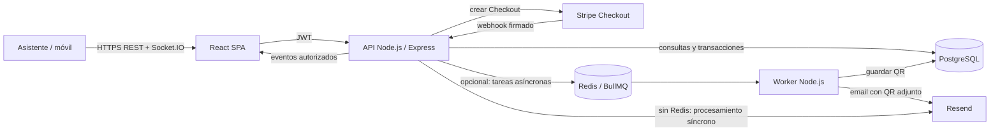

# SaaS Entradas

Una plataforma SaaS moderna e industrial para la venta y gestión de entradas de eventos en tiempo real, inspirada en sistemas de alto rendimiento y arquitectura desacoplada.

La aplicación cuenta con un catálogo público con buscador avanzado, sistema de autenticación basado en roles (comprador y organizador), procesamiento de pagos seguro mediante Stripe, generación y envío asíncrono de entradas con códigos QR en segundo plano, validación de accesos en tiempo real mediante WebSockets, y un panel de control con métricas e integración de Inteligencia Artificial para los organizadores.

---

## 🏗️ Arquitectura y Stack Tecnológico

El proyecto está diseñado bajo una arquitectura de tres capas desacoplada:

* **Frontend:** Single Page Application (SPA) construida con **React**, **Vite** y **React Router**. Utiliza estilos CSS puros optimizados y conexiones en tiempo real.
* **Backend:** Servidor API RESTful con **Express.js** y **Node.js** estructurado con controladores asíncronos y middlewares de seguridad.
* **Base de Datos & Colas:** **PostgreSQL** para la persistencia transaccional. Si se configura **Redis** + **BullMQ**, el QR/email se procesa en segundo plano; sin Redis, el backend lo procesa dentro de la petición para facilitar despliegues pequeños.
* **Integraciones Clave:**
  * **Stripe Checkout** para transacciones seguras de cobro.
  * **Socket.io** para la validación de check-in bidireccional y actualización de métricas en vivo.
  * **Resend API** para el despacho de correos electrónicos.
  * **Google Gemini AI Studio** para el copy de marketing y notificaciones.
  * **Sentry** & **Prometheus** para la observabilidad y logs estructurados mediante **Pino**.

```
SaaS_Entradas/
├── back/                 # Express, Postgres/Memory Store, Socket.io, Stripe, Worker e IA
├── front/                # React, Vite, React Router, Socket.io Client
├── docker-compose.yml    # Infraestructura local de Redis y PostgreSQL
└── smoke-test.js         # Pruebas automatizadas post-despliegue
```

### Diagrama y decisiones de arquitectura



PostgreSQL es la fuente persistente para usuarios, eventos y entradas; Redis/BullMQ puede separar la generación del QR y el correo de la petición de compra. En el despliegue gratuito descrito abajo se omite Redis y se procesa el QR/email de forma síncrona tras el webhook. El pago se delega a Stripe Checkout y solo el webhook firmado confirma la compra, por lo que la aplicación no recibe ni almacena datos de tarjetas. Socket.IO actualiza las métricas y el check-in en tiempo real; el acceso a las salas se limita al organizador propietario del evento. El modo en memoria es únicamente para desarrollo y demostraciones.

---

## ⚡ Guía de Inicio Rápido (Modo Demo)

Para arrancar el proyecto en tu entorno local sin necesidad de configurar claves externas:

1. **Instalar dependencias y arrancar el backend:**
   ```bash
   cd back
   npm install
   npm run dev
   ```
   *El servidor API estará disponible en [http://localhost:4100](http://localhost:4100).*

2. **Instalar dependencias y arrancar el frontend:**
   ```bash
   cd front
   npm install
   npm run dev
   ```
   *La interfaz web estará disponible en [http://localhost:5174](http://localhost:5174).*

En este modo demostración la base de datos se degrada automáticamente a memoria, los pagos se simulan internamente, el backend genera el QR al procesar cada entrada y los emails se simulan en la consola del backend.

---

## ⚙️ Configuración Completa

Para conectar bases de datos reales y pasarelas de producción, copia la plantilla de variables de entorno y sigue la guía detallada:

```bash
cd back
cp .env.example .env
```

Para obtener más información sobre cómo obtener y configurar las claves de **PostgreSQL, Redis, Stripe, Resend y Gemini AI**, consulta la [Guía de Configuración](./CONFIGURACION.md).

## 🚀 Despliegue gratuito (Cloudflare Pages + Render Free + Supabase)

La aplicación se puede publicar sin un pago mensual usando Cloudflare Pages para la web estática, Render **Free** únicamente para la API y Supabase **Free** para PostgreSQL. Este perfil no crea un worker ni Redis: cada compra genera y envía el QR desde el proceso API después de recibir el webhook de Stripe. Requiere cuentas gratuitas en [Cloudflare](https://dash.cloudflare.com/), [Render](https://dashboard.render.com/) y [Supabase](https://supabase.com/dashboard); no compartas aquí claves ni contraseñas.

**Límites importantes:** la API gratis de Render se suspende tras 15 minutos sin actividad y puede tardar alrededor de un minuto en reactivarse; la base de datos gratuita de Supabase puede pausarse después de una semana de inactividad. Comprueba la página de precios/límites antes de confirmar, porque cambian. Es adecuado para demo/pruebas, no para prometer disponibilidad de un servicio comercial. Stripe puede cobrar comisiones por transacciones reales; utiliza las claves de prueba para validar el flujo.

1. **Crear Supabase:** crea un proyecto en el plan Free. En *Connect* copia una cadena PostgreSQL de **Session pooler**, compatible con conexiones IPv4. Guárdala de forma privada; será `DATABASE_URL`.
2. **Publicar la web:** conecta el repositorio a Cloudflare Pages (*Workers & Pages → Create → Pages → Connect to Git*). Configura directorio raíz `front`, comando de build `npm run build`, directorio de salida `dist` y `VITE_API_URL` como `https://api-pendiente.invalid` para el primer build. La publicación se hace al primer push/build; copia el dominio `*.pages.dev`.
3. **Crear la API en Render Free:** desde *New → Blueprint* conecta el repositorio y selecciona `render.yaml`. El Blueprint crea solo un Web Service con `plan: free`. En el formulario configura `DATABASE_URL` (Supabase), `FRONT_URL` (dominio HTTPS de Pages), `STRIPE_SECRET_KEY` de prueba y `RESEND_API_KEY`; Render genera `JWT_SECRET`. No habilites servicios ni complementos de pago. Si Render pide un método de pago o muestra costes que no aceptas, cancela antes de confirmar.
4. **Configurar Stripe y frontend:** cuando Render asigne un dominio `*.onrender.com`, crea en Stripe un endpoint `https://<api>/api/stripe/webhook` para `checkout.session.completed`. Copia el secreto `whsec_...` a `STRIPE_WEBHOOK_SECRET` en las variables de la API y espera a que se reinicie. Configura después `VITE_API_URL` en Pages con la URL real de la API y vuelve a desplegar la web. Sin el webhook configurado, el checkout se bloquea por seguridad.
5. **Verificar** `https://<api>/health` y ejecutar el smoke test:
   ```bash
   FRONTEND_URL=https://<frontend> BACKEND_URL=https://<api> node smoke-test.js
   ```
   En PowerShell:
   ```powershell
   $env:FRONTEND_URL="https://<frontend>"; $env:BACKEND_URL="https://<api>"; node smoke-test.js
   ```

Render necesita `NODE_ENV`, `FRONT_URL`, `DATABASE_URL`, `JWT_SECRET`, `STRIPE_SECRET_KEY` y `RESEND_API_KEY`. `REDIS_URL` es opcional; sin ella no hay cola/reintentos de worker, por lo que el webhook puede tardar más mientras se crean las entradas y se envían los emails. No añadas credenciales al repositorio. La cámara del validador requiere HTTPS.

La configuración deja listo el blueprint, pero no puede crear las cuentas externas ni publicar servicios en nombre del usuario. La URL pública estará disponible después de conectar el repositorio y completar los formularios en los tres proveedores.

---

## 🛡️ Roles y Accesos en la Plataforma

* **Público:** Visualización del catálogo de eventos, detalles de cada evento y búsqueda parametrizada (por provincia, fecha, categoría, precio y tipo).
* **Asistente (Comprador):** Requiere sesión. Permite comprar entradas de forma simulada o vía Stripe, registrar los nombres de los asistentes para cada ticket y acceder a su historial personal de entradas generadas con código QR.
* **Organizador:** Puede publicar eventos con aforo y precio propios; el panel protegido por rol muestra únicamente sus métricas. Accede a:
  * **Dashboard de KPIs:** Ingresos totales, entradas vendidas, tasa de asistencia, ticket medio, porcentaje de ocupación y desglose de ventas por evento.
  * **Validación en Puerta:** Escaneo QR con cámara móvil (HTTPS) o introducción manual, con distinción entre entradas válidas, ya usadas e inexistentes.
  * **Asistente de IA:** Generación automática de copys descriptivos y correos informativos.

---

## 🧪 Pruebas Automatizadas

La aplicación cuenta con una suite completa de pruebas unitarias y de integración que validan el flujo crítico:

### Backend (Jest)
Valida los filtros de búsqueda, flujos de transacciones de compra, registros de usuarios duplicados, validación de códigos de ticket únicos y cálculo agregador de métricas financieras.
```bash
cd back
npm test
```

### Frontend (Vitest & React Testing Library)
Valida el renderizado correcto del catálogo y componentes de filtrado de eventos.
```bash
cd front
npm test
```

---

## 🧪 CI/CD (GitHub Actions y Render)

El workflow de `.github/workflows/ci.yml` ejecuta las pruebas del backend/frontend y compila el frontend. Cloudflare Pages publica la SPA al conectarlo al repositorio; Render puede desplegar el Blueprint tras los checks configurados. `smoke-test.js` comprueba las URLs reales con `FRONTEND_URL` y `BACKEND_URL`; en CI falla si se ejecuta con URLs locales.
